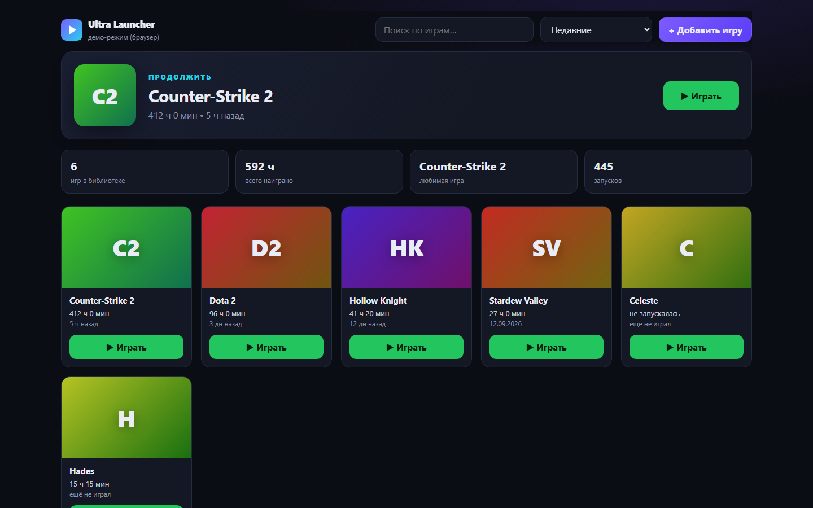

# Ultra Launcher — лаунчер для своей библиотеки игр

> Lightweight desktop game launcher with playtime tracking. Tauri 2 (Rust) + React + TypeScript.



Все игры в одном окне, откуда бы они ни были: Steam, GOG, itch.io, эмуляторы. Добавляешь `.exe`, жмёшь «Играть», а лаунчер сам считает часы, количество запусков и когда ты играл последний раз.

## Что умеет

- добавить игру через системный диалог выбора файла (`.exe`, `.lnk`, `.bat`, `.url`)
- запуск из папки игры (многие игры ищут файлы рядом с exe)
- учёт времени: Rust ждёт закрытия процесса в отдельном потоке и шлёт событие во фронт
- блок «Продолжить» с последней игрой, общая статистика
- поиск, сортировка (недавние / часы / алфавит), переименование, удаление
- обложки генерятся из названия, ничего не качается из сети

## Как устроено

```
src/              — React + TS
  App.tsx         — интерфейс
  api.ts          — вызовы Rust; в обычном браузере — демо-данные
src-tauri/src/
  lib.rs          — команды: list / add / remove / rename / launch_game
```

Библиотека хранится в `library.json` в AppData. Запись атомарная: сначала во временный файл, потом rename, чтобы не потерять данные при краше.

## Запуск

Нужны Node.js 20+, Rust и [зависимости Tauri](https://tauri.app/start/prerequisites/) (на Windows — Visual Studio Build Tools с C++ и WebView2).

```bash
npm install
npm run tauri dev      # десктоп
npm run dev            # только UI в браузере, на демо-данных
npm run tauri build    # установщик в src-tauri/target/release/bundle
```

---
Сделано [Quorvox_team](https://github.com/Quorvox)
